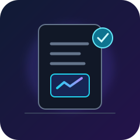
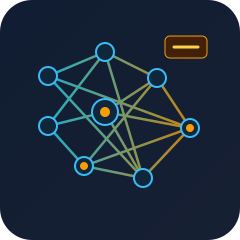

 

# PIYUSH SHARMA

### AI ENGINEER · GENERATIVE AI · AGENTIC SYSTEMS

 

---

## ⚡ What I'm Working With

AI applications that combine LLMs, retrieval systems, Python backends, and structured workflows.

| Area | Focus |
|---|---|
| Generative AI | LLM Applications, Prompt Engineering, Structured Outputs |
| Agentic AI | LangGraph, CrewAI, Multi-Agent Workflows |
| Retrieval | RAG, GraphRAG, Vector Search, Hybrid Retrieval |
| Machine Learning | Scikit-learn, XGBoost, TensorFlow, PyTorch |
| Backend | Python, FastAPI, REST APIs |
| Infrastructure | Docker, AWS, Redis |
| Databases | PostgreSQL, Neo4j, Qdrant, FAISS |

## Selected work

<table>
<tr>
<td width="112" valign="middle" align="center">

</td>
<td valign="middle">

### [FinDoc AI](https://github.com/sharma-piyush1/FinDoc-AI)

Document intelligence and automated loan underwriting.

Python · LangGraph · FastAPI · Gemini · Redis

</td>
</tr>
<tr>
<td width="112" valign="middle" align="center">

</td>
<td valign="middle">

### [TalentFlow AI](https://github.com/sharma-piyush1/TalentFlow-AI)

Multi-agent candidate sourcing and screening.

Python · CrewAI · Gemini · Exa.ai · Streamlit

</td>
</tr>
<tr>
<td width="112" valign="middle" align="center">

</td>
<td valign="middle">

### [Healthcare GraphRAG](https://github.com/sharma-piyush1/healthcare-graphrag-adversarial-cdss-v2)

Hybrid retrieval and clinical response auditing.

Neo4j · Qdrant · LangGraph · FastAPI

</td>
</tr>
<tr>
<td width="112" valign="middle" align="center">

</td>
<td valign="middle">

### [AI Tutor · Grade 10 NCERT](https://github.com/sharma-piyush1/AI-Tutor-Grade10-NCERT)

An AI learning assistant for NCERT subjects.

Python · LangChain · FAISS · Groq · Streamlit

</td>
</tr>
</table>

## 🧰 Technology Stack

### Languages & Backend

### AI / Machine Learning

### Tools & Infrastructure

  
  
  
  
  
  
  

---

